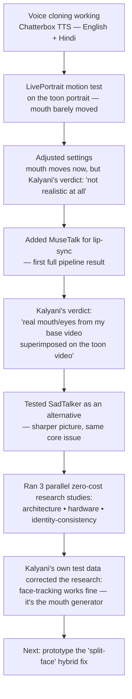
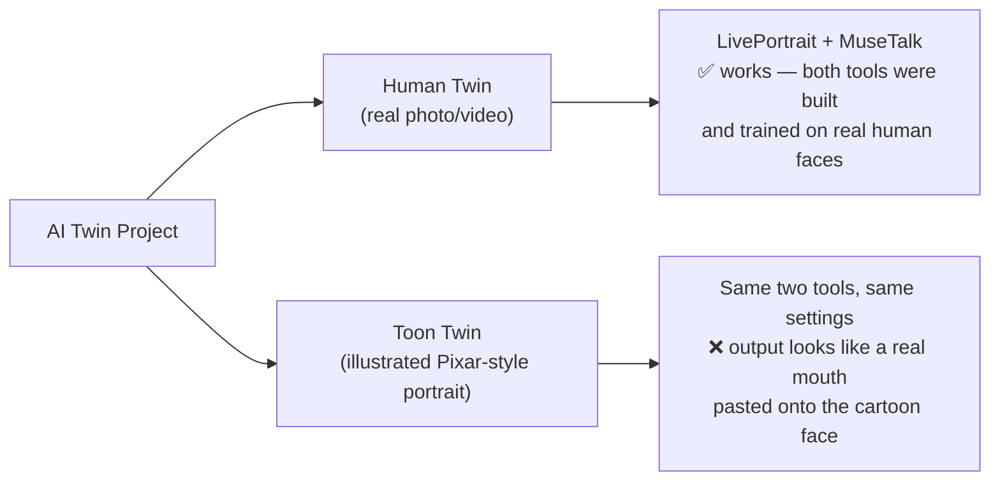
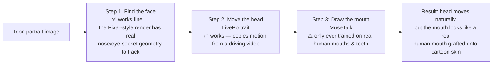
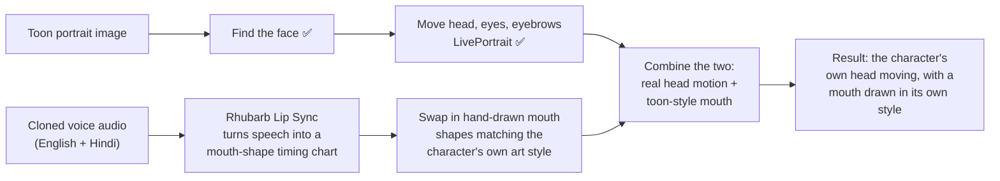

# AI Twin — journey log
*Raw record of every step, decision, and dead end. This becomes the free public tutorial once the twin meets Kalyani's bar. $0 rule: everything here uses free tools; any paid detour gets declared explicitly.*

## Ground rules
- Self-hosted / open-source (Path C). Voice samples and models stay in Kalyani's control.
- Bilingual: every video ships as two full versions, Hindi and English. No code-mixing.
- Nothing posted anywhere without explicit approval.
- Budget: $0. Free compute order of preference: local Mac (prep) → Google Colab free tier (GPU smoke tests) → NRP (real GPU runs).

## Stack decisions
| Piece | Tool | Why | License |
|---|---|---|---|
| Voice clone | GPT-SoVITS | trains on ~1 min; strong Hindi when Hindi is in the training set | MIT |
| Avatar (footage route) | MuseTalk v1.5 | lip-sync onto real footage of yourself; no per-person training | check before commercial use — field unasserted |
| Avatar (photo fallback) | SadTalker | single photo → talking head; clean Apache-2.0 license for the tutorial | Apache-2.0 |
| Audio/video prep | ffmpeg | everything | LGPL/GPL |
| Subtitles | Whisper (local) | free, good Hindi + English | MIT |

## Hardware plan (macOS reality)
- **Mac (local, conda env):** all data prep — audio cleanup, video trimming/25fps conversion, subtitle generation. GPT-SoVITS *inference* can run on Apple Silicon (slow but works).
- **GPT-SoVITS training:** needs CUDA for good results (Mac-trained models are known lower quality). → Colab free tier first; NRP when ready.
- **MuseTalk:** CUDA-only in practice. → Colab free / NRP.

## Log

### 2026-10-18 — project start
- Voice samples in hand (~4.7 min total): 72s English (postdoc story), 162s English (strategic-communication piece), 49s Hindi (film-lyrics recitation).
- 162s English + 49s Hindi samples cleaned and normalized → `prepared/voice/*.wav` (mono 44.1kHz, -19 LUFS, denoised, no clipping, no dead gaps). 72s sample still to be run through `scripts/prepare_audio.sh`.
- Decisions: start local on Mac with conda env; NRP later for GPU; $0 until declared otherwise; journey logged for the eventual public tutorial.
- 2021 YouTube lecture considered as avatar base footage — likely unsuitable (webinar framing, small webcam region); fresh phone video preferred. Base video still the main blocker.
- Scripts written: `prepare_audio.sh`, `trim_base_video.sh`, `check_base_video.sh`; `environment.yml` for the Mac conda env.

### 2026-10-18 (later) — base-video candidates inspected
- Two phone clips reviewed frame-by-frame:
  - 2025-07 clip (8K vertical, 8.4s): handheld moving camera, profile→close-up→off-camera. Not usable as MuseTalk base.
  - 2023-06 clip (514×850, 12.3s): night, full-body dancing, motion blur. Not usable.
- Salvage: one frontal, closed-mouth, well-lit frame found at t≈4.6s of the 8K clip → cropped to `prepared/portrait_sadtalker.png` (1200×1500). This unblocks the SadTalker photo route immediately.
- MuseTalk base video (60–90s static chest-up take) remains the one missing asset. Tutorial lesson: an 8-second casual clip can't substitute for one deliberate static take — but even casual footage can donate a usable SadTalker portrait.
- Workflow decision: large media stays on Kalyani's machine; `check_base_video.sh` validates locally before anything is uploaded, and GPU steps run on her side (Colab/NRP), so chat only ever carries small trimmed clips and results.

### 2026-10-18 (later) — voice stack revised after license/language check
- **Finding:** GPT-SoVITS officially supports only zh/en/ja/ko/yue — its text frontend cannot read Devanagari. The earlier "GPT-SoVITS for Hindi" assumption was wrong.
- **Revision:** primary voice tool is now **Chatterbox Multilingual V3** (Resemble AI, MIT license): zero-shot cloning (no training step), Hindi officially supported, plus a dedicated Hindi finetune (`ResembleAI/Chatterbox-Multilingual-hi`) if the general model's Hindi isn't good enough. GPT-SoVITS demoted to optional English-quality upgrade.
- **Bonus for the $0 story:** community MLX port (`mlx-community/chatterbox-multilingual-v3`) runs on Apple Silicon — voice generation may eventually run on the Mac itself, no cloud GPU.
- Note: Chatterbox embeds an imperceptible Perth watermark in all output — a responsible-AI provenance feature, worth a tutorial callout.
- Built `colab/voice_clone_smoke_test.ipynb`: Colab free T4, upload the two cleaned WAVs, renders pilot-script opening lines in EN (from English reference) and HI (Devanagari, from Hindi reference), with a tuning table (exaggeration/cfg_weight) and the accent-bleed mitigation (cfg=0).

### 2026-10-18 (later) — Colab abandoned, pivot to local conda (Kalyani's call)
- The Colab notebook hit multiple issues (the classic failure mode: Colab's preinstalled torch/numpy stack fighting chatterbox-tts's pins — a clean env doesn't have this problem).
- Decision (Kalyani): local Jupyter + conda is the preferred mode from here on.
- New: `environment-voice.yml` (separate conda env `ai-twin-voice`, python 3.11, so chatterbox's pins can't break the prep env) + `local_voice_clone.ipynb` — same smoke test, adapted for macOS: auto device pick (cuda→mps→cpu), the standard Apple-Silicon `torch.load` map_location patch, reads refs from `prepared/voice/`, writes to `out/`.
- Known limitation noted in the notebook: Intel Macs can't run torch≥2.6 (no builds) — Cell 1 reports the architecture so this surfaces immediately.
- Tutorial lesson: cloud notebooks look easier but inherit a dirty environment; a pinned conda env on your own machine is more reproducible. Local-first is the recommended path for followers with any Mac/Linux machine.

### 2026-10-18 (evening) — local install failed, root cause found
- `conda env create` failed: pip couldn't resolve `torch==2.6.0` ("no matching distributions for your environment").
- Diagnosis: `uname -m` → arm64 (Apple Silicon hardware) but conda's python → x86_64. The miniconda install itself is the Intel build, so every env it creates runs under Rosetta emulation — and PyTorch dropped Intel-Mac builds after 2.2.
- Fix: recreate the env forcing native arm64 — `CONDA_SUBDIR=osx-arm64 conda env create -f environment-voice.yml`, then `conda config --env --set subdir osx-arm64` inside it.
- Tutorial callout: this hits huge numbers of M-series Mac users who installed Intel conda years ago and never noticed. Check is one line: `python -c "import platform; print(platform.machine())"` — if it doesn't match `uname -m`, everything is emulated.

### 2026-10-18 (night) — arm64 env works; two last snags fixed
- arm64 rebuild succeeded; model downloaded; two residual issues:
  1. PyPI chatterbox-tts (0.1.7) has no `t3_model` kwarg → it ships the **V2** multilingual checkpoint. Notebook's fallback handled it; V3 / dedicated Hindi finetune remain the upgrade path if Hindi quality disappoints.
  2. `perth.PerthImplicitWatermarker` was `None` → root cause: perth imports `pkg_resources`, which modern envs no longer ship (setuptools removed/absent). Fix: `pip install "setuptools<81"` in the env, restart kernel. Interim: passthrough watermarker patch (watermarking disabled for that session only).
- Tutorial fix list for the notebook: add `setuptools<81` to environment-voice.yml pip deps; keep the perth fix cell as a self-diagnosing guard.

### 2026-10-18 (21:23) — ✅ MILESTONE: voice clone works, both languages
- After the setuptools fix: English and Hindi smoke-test outputs both judged **great** by Kalyani. The voice half of the twin is proven — $0, local Mac, zero-shot, no cloud.
- Repo-ready: README, `.gitignore` (hard-blocks all audio/image/video — voice samples are biometric identity and never get committed), fixes folded into `environment-voice.yml` (setuptools<81, CONDA_SUBDIR note) and the notebook (perth self-check cell). Plan: private GitHub repo now, public when the tutorial is approved.

### 2026-10-18 (late) — base video QC'd + local avatar path chosen
- Kalyani's prepped clip (1080×1920@25fps, 21.7s): framing/lighting/face-size pass; camera is handheld (background drift measured across frames) and short → approved as PIPELINE-TEST base; production base = same setup, phone propped, plain wall, 60–90s.
- Her Mac: 64GB unified memory; priority is accuracy (face, gestures, lip-sync), not speed — overnight CPU renders acceptable.
- Reviewed an external AI's "local video models" list: LTX/Wan/MiniMax are *generative* text-to-video — wrong tool class for a twin (they invent footage; the twin needs audio-driven lip-sync of real footage). MiniMax-as-local claim was wrong (closed API). Tutorial lesson: know the difference between generating video and lip-syncing your own.
- **Decision: MuseTalk locally on the Mac, CPU.** Verified against the actual repo: inference has a built-in CPU fallback (no CUDA hardcoding in the main path), fp16 is opt-in, tensorflow in requirements is unused at inference. The one heavy dep is the MMLab stack (mmpose for landmarks) — mmcv 2.0.1 compiles from source on Mac (~20-40 min). Official pins mirrored exactly: py3.10, torch 2.0.1, mmcv 2.0.1, mmdet 3.1.0, mmpose 1.1.0.
- Kit written: `avatar/setup_avatar_mac.sh` (env + deps + ~6GB weights; HF mirror endpoint removed from upstream script) and `avatar/run_avatar_mac.sh` (video+audio → results/, with `caffeinate -i` tip for overnight runs).
- NRP stays the fast path for production renders; local Mac is the sovereign path. SadTalker dropped: photo route can't carry real gestures.

### 2026-10-19 (~1am) — ✅ MILESTONE: MuseTalk runs locally; rung 2 passed
- Install walls conquered, in order: (1) setuptools/pkg_resources for perth, (2) same for mmcv's build, (3) clang-vs-torch-2.0.1 header (`-Wno-invalid-specialization`), (4) chumpy's `import pip`, (5) xtcocotools' `import numpy` (both cured by `--no-build-isolation`), (6) huggingface_hub 2.x upgrade trap (pin 0.30.2 — upstream's `-U` flag), (7) gdown dropped `--id` syntax. All fixes folded into `setup_avatar_mac.sh`.
- Rung 2 (self-reconstruction: base video + its own audio) rendered on CPU and verified against the original frame-by-frame: clean lip edges, convincing teeth, no jaw seam or box artifact; only slight mouth-region softness. Full avatar pipeline proven local, $0.
- Remaining: rung 3 — base video + CLONED Hindi/English audio = the actual twin.

### 2026-10-19 — first upstream contribution 🎉
- Filed [TMElyralab/MuseTalk#427](https://github.com/TMElyralab/MuseTalk/issues/427): `download_weights.sh` broken with current gdown (`--id` flag removed), with verified one-line fix and PR offer. Searched for duplicates first — the one "gdown" hit (#334) was an unrelated GPU thread matching on a comment.
- Giving-back loop now runs both ways: this repo credits upstream (ACKNOWLEDGMENTS.md); upstream's tracker now carries our find.
- Pending: macOS build-notes issue (clang flag + mmcv recipe) after bbox_shift tuning settles; PR for #427 if maintainers welcome it.

### 2026-10-20 — tuning + toon + new bases
- bbox_shift sweep verdict: **−5 beats +5 and 0** on the handheld base — matches the measured symptom (mouth open during audio pauses → negative shift reduces openness). −5 is the starting point for new bases, re-bisect per base since framing moves the optimum.
- Toon experiment: MuseTalk accepted a DreamWorks-style AI portrait as input (their own monalisa.png demo foreshadowed it) — mouth articulates, style preserved, lip color desaturated (known limitation), head frozen (still-image route). Cartoon twin = viable bonus format; toon *video* base is the future upgrade.
- Two fresh purpose-shot bases (one Hindi speech, one English) in hand → full v2 pipeline run: new natural-speech voice references harvested from their audio, language-matched base/audio pairing, renders at shift −5.

### next up
- [x] Push repo (private) to GitHub
- [x] Prepare the 72s English sample with `prepare_audio.sh` (third reference option)
- [x] Render the FULL pilot scripts (EN + HI) with the working voice — memory slot still awaits
- [x] Shoot/trim one static 60–90s chest-up base video → `check_base_video.sh`
- [x] Avatar step (SadTalker portrait route first) — needs CUDA → NRP or Colab
- [ ] Optional quality ladder if wanted: Chatterbox V3 / dedicated Hindi finetune
## 2026-11-21 — Toon Avatar: Why It Looked "Off," and the Plan to Fix It

### TL;DR (30-second read)
We built a pipeline to animate an illustrated cartoon version of Kalyani using her own cloned voice. The first full result worked technically (right length, right audio, mouth actually moving) but looked wrong — like a real human mouth had been pasted onto a cartoon face. We tested a second tool (SadTalker) and got the same underlying issue. We then ran a structured, zero-cost research pass to understand why, and the answer turned out to be more specific — and more fixable — than it first looked: **the face-tracking part of the pipeline works fine on this character; it's specifically the part that draws the mouth that was never trained on anything but real human mouths.** The new plan keeps the parts that work and replaces only the part that doesn't.

---

### The goal, in plain English

Kalyani is building a personal "AI twin" — a video of herself (and a cartoon version of herself) that talks in her own cloned voice, in English and Hindi, for short social videos. Everything is free, open-source, and runs on her own Mac or free academic computing — no paid subscriptions, no sending data to a company's servers.

There are two "twins" in this project:
- **Human Twin** — uses a real photo/video of Kalyani. The tools involved were built and tested on real human faces, so this track mostly works as expected.
- **Toon Twin** — uses an AI-illustrated, Pixar-style cartoon portrait of Kalyani. This is the one giving trouble, and it's the subject of this update.

### The journey so far

### What we built, and what it actually does

**What each tool actually does, in plain language:**
- **LivePortrait** — watches a video of Kalyani's real head moving and copies that motion (head tilt, blinks, nods) onto a still portrait. It does not listen to audio at all.
- **MuseTalk** — listens to the cloned-voice audio and redraws just the mouth area, frame by frame, to match the words being spoken.
- **SadTalker** — a different tool that does both of the above (motion + mouth) in one single step instead of two.
- **Rhubarb Lip Sync** — a much older, simpler, non-AI tool: it listens to audio and outputs a timing chart saying "mouth shape A from 0.2s to 0.5s, shape C from 0.5s to 0.9s," etc. It doesn't draw anything itself — it tells something else when to show a pre-made mouth-shape picture.
- **LoRA (fine-tuning)** — a way of showing an AI image model 15–30 pictures of one specific character so it learns to draw *that* character consistently, in new poses/outfits, instead of drawing a generic face each time.

### The problem we found, step by step

The important nuance here, confirmed by checking MuseTalk's own code directly: it genuinely does use a legitimate pose/landmark detector (called DWPose) that works fine on a 3D-style cartoon face — this matches Kalyani's own result of successfully tracking all 437 frames of the test clip. So **the detection step is not the problem.** The problem is narrower and more specific: the *mouth-drawing* step was built exclusively on footage of real people talking, so it doesn't know how to draw a mouth in the character's own illustrated style — it just draws a realistic human mouth, wherever the mouth should be.

### What the zero-cost research confirmed

We ran three independent research passes (architecture comparison, hardware feasibility, identity consistency) before committing to any next step. Headlines:

- **No open-source tool we found — not one — has verified, documented proof it works well on illustrated/cartoon faces.** Every one of them (SadTalker, Hallo, EchoMimic, AniPortrait, V-Express, LatentSync, LivePortrait, MuseTalk) was built and tested on real human faces. One tool's own demo video claiming to show "anime" results turned out to be borrowed footage from a *different* company's model — not its own output. This is a real, field-wide gap, not something unique to Kalyani's setup.
- **Only one tool (LivePortrait) has official support for running on a Mac at all** — and even that is roughly 20x slower than a dedicated gaming GPU, by the tool's own documentation. Everything else expects a Linux computer with an NVIDIA graphics card.
- **For free cloud computing:** Google Colab's free tier is real but Google doesn't promise which graphics card you'll get or for how long. Kalyani's academic computing allocation (NRP/Nautilus, through UAMS/Arkansas INBRE) is structurally the better free option — real, more powerful graphics cards, no surprise cutoffs — as long as it's used deliberately and not left idling.
- **For keeping the cartoon character looking like "herself" across different outfits/backgrounds:** the popular easy tools for this (IP-Adapter, InstantID, PhotoMaker) are all built to recognize *real human faces* — one of them, PhotoMaker, literally tells its own users to avoid cartoon-style images. The one method that doesn't have this problem is LoRA fine-tuning (teaching the AI 15-30 pictures of the specific character).

### The plan: a "split-face" hybrid, instead of starting over

Because the head-motion part already works and only the mouth-drawing part is the problem, the fix doesn't need to throw out everything and start from scratch — it needs to replace one piece.

This is not a brand-new invention — it's a recognized pattern in the lip-sync research field ("mask-based" dubbing, where only the mouth region is edited and everything else is left alone). MuseTalk itself already works this way internally; we're proposing to swap *what* fills that mouth region — a hand-styled viseme instead of a real-face AI generation.

**One known risk to test for, not assume away:** when you paste a new mouth onto an existing frame, the edges can show a visible seam if the lighting/style doesn't match exactly. For a flat illustration this is more forgiving than for a photo-real face, but it's the first thing to check once this is prototyped.

### Zero-cost hardware map

| Option | Cost | Good for | The catch |
|---|---|---|---|
| Kalyani's Mac (Apple Silicon) | $0, always on hand | Rhubarb (needs no GPU at all), LivePortrait motion | LivePortrait runs ~20x slower than a gaming PC, by its own documentation |
| Google Colab (free tier) | $0 | A quick one-off test | Google does not guarantee which graphics card or how long a session lasts |
| NRP / Nautilus (academic allocation via UAMS/Arkansas INBRE) | $0 | Longer, repeatable test/training runs | Must be used deliberately — leaving a graphics card idling can get an account flagged |

### What to test next (open questions)

1. Does Rhubarb's speech-timing accuracy hold up on real Hindi audio, including sounds English doesn't have? (Planned, not yet run.)
2. Does the hybrid "split-face" composite actually blend cleanly, or is there a visible seam around the mouth? (Not yet built.)
3. Does a LoRA trained on the toon character actually help with outfit/background consistency once there's motion involved, not just still images? (Not yet tested — the research only confirmed LoRA for still images.)

### Standing ground rules carried through this entire project
No religious content. No email/calendar access. Nothing posted anywhere without Kalyani's explicit approval. Voice cloning only with explicit consent. No biometric media (face/voice/video) ever committed to this git repo — this note is text and diagrams only, by design. Conda-first installs; pip only when conda genuinely has no package. Free/open-source/self-hosted tools only — no paid APIs.
